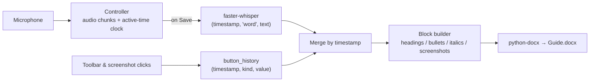

# Documentation Automater

**Speed up document/SOP creation by 10x. Walkthrough a process, talk, screenshot, and edit text on the go and turn it all into a finished Word document.**


<!-- Add a demo GIF or screenshot here once recorded, e.g.:

-->

## About

Writing SOPs and technical documentation by hand is slow: perform the task, screenshot every step, type up what happened, then format everything afterward. Browser-based tools like Scribe don't cover desktop applications, and most are paid.

**Documentation Automater** removes the "afterward." Work through your task as you normally would, narrating out loud, formatting text with a small toolbar, and drag-selecting screenshots as you go. When you hit **Stop** and **Save**, everything you said, formatted, and captured is assembled into a `.docx` in the exact order it happened. It works for **desktop and browser applications** alike, and in my own workflow it cuts documentation time by roughly 10x.

It was also built to pass a corporate IT review. See [Built for Locked-Down Workplaces](#built-for-locked-down-workplaces).

## Features

- **Voice-to-document**: speech is transcribed locally with [faster-whisper](https://github.com/SYSTRAN/faster-whisper) (`small.en`, CPU) with per-word timestamps.
- **Live formatting toolbar**: a floating, collapsible, always-on-top bar for headings (H1-H4), italics, bullet/numbered lists, and inline arrows (→).
- **Drag-to-capture screenshots**: a full-screen overlay lets you select exactly the region you want. Choose **Save** or **Edit** on release.
- **Built-in screenshot editor**: draw rectangles and arrows, pick colors, and undo with Revert before saving.
- **Chronological output**: words, formatting, and screenshots land in the document in the order they were captured.
- **Smart pause**: recording pauses automatically while you take a screenshot and resumes when you close the overlay.
- **Project/guide organization**: guides live in `Projects/<Project>/<Guide>/`, each with its own `screenshots/` folder and `<Guide>.docx`.
- **Recording state machine**: Record / Pause / Stop / Save / Clear with clear on-screen status; follows system light/dark theme.

## How It Works

Two independent event streams share one clock and are merged at save time:



1. **Capture**: audio is buffered only while recording, and a clock advances only during unpaused time. That keeps Whisper's word timestamps and toolbar-click timestamps on the same timeline, even across pauses and screenshot sessions.
2. **Transcribe**: on **Save**, the Whisper model is loaded (lazily, so Record stays instant) and returns `(timestamp, "word", text)` tuples.
3. **Merge**: transcript words and UI events (`heading`, `italic_on/off`, `bullet`, `arrow`, `block_end`, `screenshot`) are sorted into one event list.
4. **Build**: a state machine using Python's `match` statement groups events into `Block`s, then writes paragraphs, headings, list items, italic runs, and images (capped at 6" × 8") with `python-docx`.

A single `Controller` is created per recording session and passed down through `HomePage → MainSideMenu → CaptureOverlay → EditMenu`, so every action lands in the same event log.

## Built for Locked-Down Workplaces

Designed around the constraints of a corporate IT environment:

- **Only captures what you select**: screenshots are limited to the rectangle you drag. There is no full-screen, background, or scheduled capture.
- **No keylogging or global hooks**: input comes only from clicks inside the app's own windows. No mouse-element or UI-tree capture (unlike Steps Recorder).
- **Local transcription**: speech is processed on-device by faster-whisper. Audio is never uploaded, and the app code makes no network calls. The only download is the one-time model fetch on first use.
- **Visible recording state**: a clear "● Recording / ⏸ Paused / ⏹ Stopped" indicator, plus automatic pause during screenshots.
- **Small footprint**: project output goes to a folder you choose, and app settings are a single JSON file in `%APPDATA%`. The capture UI is pure Tkinter + Pillow, so it's easy to audit.

## Tech Stack

| Area | Tools |
|---|---|
| Language | Python 3.12+ |
| GUI | CustomTkinter, Tkinter, CTkColorPicker, Pillow |
| Speech-to-text | faster-whisper (CTranslate2), NumPy, sounddevice |
| Document output | python-docx |
| Windows integration | `ctypes` (DPI handling), Tk window attributes (alpha / color-key transparency) |

## Getting Started

### Prerequisites

- Windows 10/11
- Python 3.12 or newer
- A working microphone
- Internet access once, to download the Whisper model on first save (it's cached and runs offline afterward)

### Install

```powershell
git clone https://github.com/adrianelowerycoding/Documentation-Automer-.git
cd Documentation-Automer-

python -m venv .venv
.venv\Scripts\activate

pip install customtkinter CTkColorPicker pillow numpy sounddevice faster-whisper python-docx
```

### Run

```powershell
python GUI/main.py
```

## Usage

1. **New Guide**: on first run, choose a root folder for your projects. Then create or load a **Project** and name your **Guide**.
2. **● Record**: the formatting toolbar docks to the right edge of your screen. Start doing your task and talking through it.
3. **Format as you go** with the toolbar:
   | Button | Action |
   |---|---|
   | Heading | Start/end an H1-H4 heading (click again to end) |
   | Italics | Toggle italic text |
   | Bullet | Start/end a bullet or numbered list |
   | → | Insert an arrow |
   | Camera | Open the screenshot overlay |
4. **Screenshot**: drag over the area you want, then **Save**, or **Edit** to annotate with shapes and colors first. Close the overlay with the red ✕ to resume recording.
5. **⏸ Pause** any time; press **●** to resume.
6. **⏹ Stop**, then **Save**. Your document appears at `Projects/<Project>/<Guide>/<Guide>.docx`.

## Project Structure

```
Documentation-Automer-/
├── Assets/                  # Toolbar icons
├── GUI/
│   ├── main.py              # App entry point: window, sidebar, page routing
│   ├── home_page.py         # Record / pause / stop / save / clear state machine
│   ├── new_guide_window.py  # Project + guide creation, root-folder prompt
│   ├── main_side_menu.py    # Floating formatting toolbar
│   ├── screenshot_window.py # Drag-to-capture overlay (coordinated transparent windows)
│   ├── edit_menu.py         # Screenshot editor: shapes, color, revert
│   ├── settings_manager.py  # JSON settings in %APPDATA%
│   └── ...                  # base page, constants, recording state, settings pages
├── Guts/
│   ├── Controller.py        # Audio capture, active-time clock, event log
│   ├── Transcription.py     # faster-whisper wrapper
│   └── Document_Creation.py # Event merge → blocks → .docx
└── Documentation/           # Dev notes: ideas, challenges, to-dos
```

`GUI/GUI Tests/` and `Guts/Guts Tests/` hold standalone prototypes used to develop individual components.

## Engineering Highlights

- **Windows DPI scaling**: the app runs DPI-unaware for consistent layout, so Tk reports "logical" pixels while screen capture needs physical ones. Capture and editor coordinates are converted between the two, so screenshots are correct on 100%, 125%, and 150% displays.
- **Transparent overlay stack**: the capture overlay coordinates several borderless windows: a color-keyed border, a near-invisible alpha "glass" layer that is still hit-testable for drag events, a selection box, a save/edit popup, and a close control. Z-order is actively maintained against the OS reshuffling topmost windows.
- **Event-sourced documents**: rather than editing a document live, everything is logged as timestamped events and rendered once at the end. That keeps recording lightweight and makes pause/resume trivial.

## Roadmap

- [ ] Project profiles and customizable keybinds (settings pages are currently UI scaffolding)
- [ ] In-app Instructions page
- [ ] Optional screenshots-folder toggle in New Guide
- [ ] Screenshot naming tied to the current heading
- [ ] Text and freehand annotation in the screenshot editor

## Author

Built by [@adrianelowerycoding](https://github.com/adrianelowerycoding).
