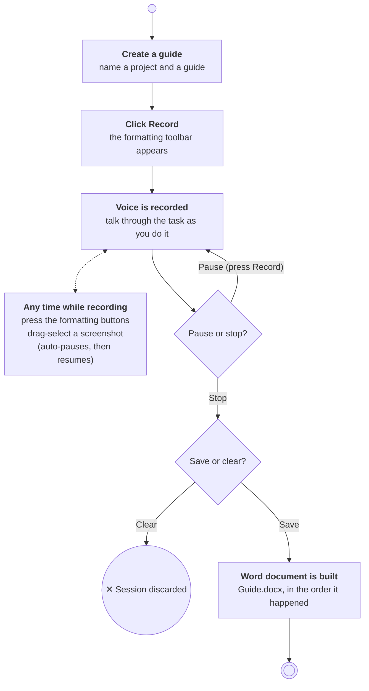

# Documentation Automater

**Speed up document/SOP creation by 10x. Walkthrough a process, talk, screenshot, and edit text on the go and turn it all into a finished Word document.**


<!-- Add a demo GIF or screenshot here once recorded, e.g.:

-->

## ℹ️ About

Documentation Automater is my free take on solving one of the most annoying, time-consuming tasks: Creating process documentation. I've spent countless hours making huge documents by hand: perform the task, screenshot every step, type up what happened, then format everything afterward. Tools like Scribe do a great job of tackling this issue, but it only works on the browser, and it's paid.

**Documentation Automater** removes most of the friction for document creation. Work through your task as you normally would, narrating out loud, formatting text with a small toolbar, and drag-selecting screenshots as you go. When you hit **Stop** and **Save**, everything you said, formatted, and captured is assembled into a `.docx` in the exact order it happened. It works for **desktop and browser applications** alike, and in my own workflow it cuts documentation time by roughly 10x.

It was also built with corporate IT policies in mind. See what features I've included: [Built for Locked-Down Workplaces](#built-for-locked-down-workplaces).

## 🌟 Highlights

- **Voice-to-document**: speech is transcribed locally with [faster-whisper](https://github.com/SYSTRAN/faster-whisper) with per-word timestamps.
- **Live formatting toolbar**: a floating, collapsible, always-on-top bar for headings (H1-H4), italics, bullet/numbered lists, and inline arrows (→).
- **Drag-to-capture screenshots**: a full-screen overlay lets you select exactly the region you want. Choose **Save** or **Edit** on release.
- **Built-in screenshot editor**: draw rectangles and arrows, pick colors, and undo with Revert before saving.

## 🔒 Built for Locked-Down Workplaces

Designed around the constraints of a corporate IT environment:

- **Only captures what you select**: screenshots are limited to the rectangle you drag. There is no full-screen, background, or scheduled capture.
- **No keylogging or global hooks**: input comes only from clicks inside the app's own windows. No mouse-element or UI-tree capture (unlike Steps Recorder).
- **Local transcription**: speech is processed on-device by faster-whisper. Audio is never uploaded, and the app code makes no network calls. The only download is the one-time model fetch on first use.
- **Visible recording state**: a clear "● Recording / ⏸ Paused / ⏹ Stopped" indicator, plus automatic pause during screenshots.
- **Small footprint**: project output goes to a folder you choose, and app settings are a single JSON file in `%APPDATA%`. The capture UI is pure Tkinter + Pillow, so it's easy to audit.

## ✍️ Authors

I'm Adrian Lowery ([@adrianelowerycoding](https://github.com/adrianelowerycoding)). I'm an aspiring SWE trying to create both open-source solutions to common automation problems and contribution opportunities to those who need it. 

## 🚀 Usage

Here are the steps you follow to create documentation: 

1. **New Guide**: on first run, choose a root folder for your projects. Then create or load a **Project** and name your **Guide**.
2. **● Record**: the formatting toolbar docks to the right edge of your screen. Start doing your task and talking through it.
3. **Format as you go** with the toolbar:
   | Button | Action |
   |---|---|
   | Heading | Start/end an H1-H4 heading (click again to end) |
   | Italics | Toggle italic text |
   | Bullet | Start/end a bullet or numbered list |
   | → | Insert an arrow |
   | Camera | Open the screenshot overlay |
4. **Screenshot**: drag over the area you want, then **Save**, or **Edit** to annotate with shapes and colors first. Close the overlay with the red ✕ to resume recording.
5. **⏸ Pause** any time; press **●** to resume.
6. **⏹ Stop**, then **Save**. Your document appears at `Projects/<Project>/<Guide>/<Guide>.docx`.



## ⬇️ Getting Started

### Prerequisites

- Windows 10/11
- Python 3.12 or newer
- A working microphone
- Internet access once, to download the Whisper model on first save (it's cached and runs offline afterward)

### Install

```powershell
git clone https://github.com/adrianelowerycoding/Documentation-Automer-.git
cd Documentation-Automer-

python -m venv .venv
.venv\Scripts\activate

pip install customtkinter CTkColorPicker pillow numpy sounddevice faster-whisper python-docx
```

### Run

```powershell
python GUI/main.py
```

## 🧰 Tech Stack

| Area | Tools |
|---|---|
| Language | Python 3.12+ |
| GUI | CustomTkinter, Tkinter, CTkColorPicker, Pillow |
| Speech-to-text | faster-whisper (CTranslate2), NumPy, sounddevice |
| Document output | python-docx |
| Windows integration | `ctypes` (DPI handling), Tk window attributes (alpha / color-key transparency) |
